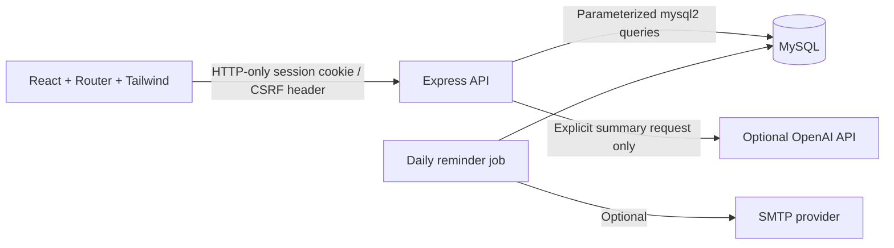
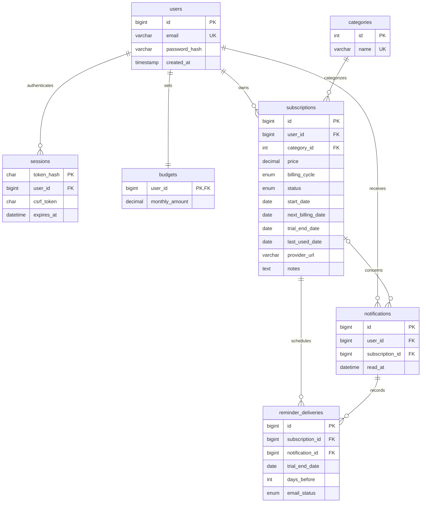

# TrialGuard

**Your subscriptions, in control.** TrialGuard is a complete JavaScript application for tracking recurring plans, avoiding forgotten free trials, and understanding spending in INR. It uses React, Vite, Tailwind CSS, React Router, Express, and persistent MySQL storage.

All dashboard values come from the signed-in user's database records. Nothing silently switches to demo data when the database is unavailable. The optional seed creates clearly fictional services in MySQL.

## Premium UI

Visit `/welcome` for the public landing page and interactive, clearly labeled demo. The real workspace includes shadcn/ui dialogs, sheets, calendars and menus, a Ctrl/Cmd+K command palette, notification popover, and Recharts spending visualization. See `PREMIUM-UI.md` for the component map and verification.

## Command-center design

The UI now includes coordinated warm-ivory and charcoal themes, locally bundled Manrope/Inter fonts, Motion for React interactions, and shared deadline indicators. The header offers subscription search, theme switching, notifications, and an account menu. Appearance follows the device initially; Settings offers system/light/dark preferences. Only this appearance preference is stored in localStorage; all application records remain in MySQL.

The dashboard includes a deadline-aware trial-protection banner, monthly/annual amounts, a category donut chart with keyboard-accessible legend controls and tooltips, a budget meter, renewal timeline, real rule-based insights, and a subscription lineup. Free Trials includes an urgent section, nearest deadline, timeline/calendar toggle, provider links, and confirmed tracker-only cancellation. Subscriptions uses status tabs and becomes compact cards on mobile.

Add/edit dialogs provide grouped fields, inline validation, a live plan summary, unsaved-change protection, Radix focus trapping, and Escape handling. The mobile drawer also traps keyboard focus, restores it on close, and scrolls independently. Motion is short and reduced-motion preferences are respected. Deadline labels refresh at the app-timezone date boundary (within 15 seconds) and immediately when the tab regains focus.

Reusable UI modules and centralized tokens live in `frontend/src/ui/`. See `REDESIGN.md` for the file map, verification, and screenshots.

## What you can do

- Register, sign in, sign out, and return to a private workspace.
- Create, edit, search, filter, sort, paginate, and delete subscriptions.
- Record provider cancellation URLs, notes, and manual last-used dates.
- Track active, trial, and cancelled plans separately.
- Review monthly and annual spending, category charts, upcoming payments, overdue dates, budget balance, and possible trial conversion costs.
- Receive persistent in-app reminders 3 days and 1 day before a trial ends. Export all-day calendar events with both reminders.
- Review rule-based insights for 30-day inactivity, category overlap, budget overruns, and upcoming trial deadlines. Select plans to estimate savings.
- Optionally request an AI spending summary or deliver reminders through SMTP.

Marking a subscription cancelled **only updates the tracker**. Cancel with the provider to stop billing. The app never charges anyone, cancels external plans, rolls dates forward, or assumes that a trial converted. Gmail and bank accounts are not connected.

## Project layout

```text
trialguard/
  backend/
    migrations/001_initial.sql  Versioned schema
    schema.sql                  Readable initial schema
    example-queries.sql         JOIN, GROUP BY, aggregates, trial detection
    scripts/                    Migration, fictional seed, manual reminder job
    src/
      controllers/              Authentication, subscription, analytics handlers
      services/                 Ownership queries, decimal math, calendar dates
      middleware/               Sessions, CSRF, origin checks, API errors
      jobs/                     Durable reminder delivery
      routes.js                 API endpoints and rate limits
      app.js                    Express setup and production static hosting
      server.js                 HTTP listener and daily scheduler
      db.js                     MySQL pool and transaction helper
      validation.js             Zod request validation
    tests/                      Unit and real-MySQL integration tests
  frontend/
    src/main.jsx                Responsive pages, forms, native modal dialogs
    src/api.js                  Credentialed API client and formatting
    src/styles.css              Tailwind and custom forest/lime design
  tests/browser.spec.js         End-to-end desktop and mobile user journey
  tests/design.spec.js          Themes, deadlines, editor safety, responsive regressions
  playwright.config.js          Browser test configuration
  docker-compose.yml           Persistent MySQL 8.4 service
```

## Architecture and data model





All monetary fields use `DECIMAL(12,2)`. mysql2 returns decimal strings; `decimal.js` performs calculations without binary floating-point rounding. A yearly plan contributes price ÷ 12 to monthly totals; the total is rounded only for output. Trials and cancelled plans are excluded from paid totals. Annual projection is the unrounded monthly sum × 12. It is a current-rate projection, not a historical spending report. The frontend uses numbers only to format already-calculated amounts and size chart bars.

Billing fields use MySQL `DATE` and are returned as strings. Calendar arithmetic uses UTC midnight solely to compare calendar dates, avoiding daylight-saving shifts. Today's date and the scheduler use `APP_TIMEZONE` (default `Asia/Kolkata`). Unknown usage dates do not count as inactivity. A zero budget means no budget target; the dashboard still reports the arithmetic balance.

Sessions store SHA-256 hashes of random 256-bit tokens. Passwords use bcrypt with cost 12 and a 72-byte maximum. All private reads and mutations enforce ownership, including direct-ID requests, notifications, exports, and savings calculations. Cookies are HTTP-only and SameSite=Lax, with Secure and the `__Host-` prefix in production. Mutations require the exact configured Origin and, after authentication, the session's CSRF token. Sign-in and registration share a per-IP rate limit. Run one API process locally; multi-instance production deployments need a shared rate-limit store and carefully configured reverse-proxy trust.

## Quick start on Windows PowerShell

Prerequisites: Node.js 22.12+ or a newer supported version, npm, and MySQL 8+ (or Docker Desktop). Use `npm.cmd` if PowerShell blocks `npm.ps1`.

From this project folder:

```powershell
npm.cmd install
npm.cmd run setup
Copy-Item backend/.env.example backend/.env
Copy-Item backend/.env.test.example backend/.env.test
```

Do not overwrite existing `.env` files when using the already-configured workspace. The app reads backend configuration relative to the backend folder; the root scripts set that working directory automatically.

### Option A: Docker MySQL

Choose strong local passwords and keep them out of source control:

```powershell
$env:MYSQL_ROOT_PASSWORD = 'choose-a-root-password'
$env:MYSQL_PASSWORD = 'choose-an-app-password'
docker compose up -d
docker compose ps
docker compose exec mysql mysql -uroot -p
```

At the MySQL prompt, create a separate test database and grant the Compose-created app user access:

```sql
CREATE DATABASE trialguard_test CHARACTER SET utf8mb4 COLLATE utf8mb4_unicode_ci;
GRANT ALL PRIVILEGES ON trialguard_test.* TO 'trialguard'@'%';
exit
```

In both backend env files set `DB_PASSWORD` to the app password. Use `DB_NAME=trialguard` for `.env` and `DB_NAME=trialguard_test` for `.env.test`. The defaults connect to `127.0.0.1:3306`. The database volume persists when containers stop.

### Option B: Existing MySQL

Log in as a database administrator (the executable may be under `C:\Program Files\MySQL\MySQL Server 8.0\bin\mysql.exe`):

```powershell
& 'C:\Program Files\MySQL\MySQL Server 8.0\bin\mysql.exe' -u root -p
```

Then run:

```sql
CREATE DATABASE trialguard CHARACTER SET utf8mb4 COLLATE utf8mb4_unicode_ci;
CREATE DATABASE trialguard_test CHARACTER SET utf8mb4 COLLATE utf8mb4_unicode_ci;
CREATE USER 'trialguard'@'localhost' IDENTIFIED BY 'choose-an-app-password';
GRANT ALL PRIVILEGES ON trialguard.* TO 'trialguard'@'localhost';
GRANT ALL PRIVILEGES ON trialguard_test.* TO 'trialguard'@'localhost';
exit
```

Configure `DB_HOST`, `DB_PORT`, `DB_USER`, and `DB_PASSWORD` in both env files to match. Use a migration account with DDL permissions for setup; a deployed runtime account only needs SELECT, INSERT, UPDATE, and DELETE on the application schema.

### Migrate and start

```powershell
npm.cmd run db:migrate
npm.cmd run dev
```

Open **http://127.0.0.1:5173** and create an account. The API listens on **http://127.0.0.1:3001**. Check **http://127.0.0.1:3001/api/health** for database connectivity. Use `127.0.0.1` consistently; switching to `localhost` changes the Origin and will correctly fail mutation checks unless you update `APP_ORIGIN`.

Migrations run in version order and record completed files in `schema_migrations`, under a MySQL advisory lock. MySQL DDL implicitly commits: if an initial migration is interrupted halfway, inspect the schema before retrying; do not delete an existing application database. `schema.sql` is a readable snapshot, not an additional migration to run after the migration command.

Optional fictional sample data:

```powershell
$env:DEMO_PASSWORD = 'choose-a-demo-password-at-least-12-characters'
npm.cmd run db:seed
Remove-Item Env:DEMO_PASSWORD
```

Sign in with `demo@trialguard.local` and the password you chose. Seeding refuses to overwrite an existing demo account and is disabled in production.

## Configuration reference

| Variable | Purpose |
| --- | --- |
| `NODE_ENV` | `development`, `test`, or `production` |
| `PORT` | API port, default 3001 |
| `APP_ORIGIN` | Exact browser origin; required HTTPS in production |
| `DB_HOST`, `DB_PORT`, `DB_USER`, `DB_PASSWORD`, `DB_NAME` | MySQL connection; never sent to the browser |
| `APP_TIMEZONE` | IANA timezone for today's date and reminder schedule |
| `REMINDER_CRON` | Default `0 9 * * *`: daily at 09:00 |
| `SMTP_HOST`, `SMTP_PORT`, `SMTP_SECURE` | Optional SMTP server and TLS settings; use 465 with secure=true or 587 with STARTTLS |
| `SMTP_USER`, `SMTP_PASSWORD`, `SMTP_FROM` | Optional SMTP credentials and sender |
| `OPENAI_API_KEY`, `OPENAI_MODEL` | Optional backend-only AI key and compatible chat model |
| `DEMO_PASSWORD` | Required only while running the development seed |
| `ENV_FILE` | Optional backend env-file path; defaults to `.env` |
| `API_PROXY_TARGET` | Frontend development proxy target; default `http://127.0.0.1:3001` |

No credentials belong in frontend env files. No secrets are included in example files. Local configured env files and dependencies are gitignored.

## Reminders, email, and AI

The API process runs the scheduled job. To run it immediately:

```powershell
npm.cmd run reminders
```

For each eligible trial, a transaction locks the subscription, rechecks its status and date, inserts a notification, and records delivery. A unique key on `(subscription_id, trial_end_date, days_before)` prevents duplicates across concurrent runs and restarts. Editing a trial's end date creates a new deadline with its own reminder schedule. Cancelling the tracker entry stops future reminders. Deleting a subscription retains its notification history with a null subscription reference.

No SMTP configuration means in-app reminders continue with email status `unavailable`. SMTP delivery is claimed once in MySQL, with states pending → sending → sent/failed. Failed or interrupted sends are not automatically retried: SMTP cannot guarantee exactly-once delivery after an ambiguous network failure. Inspect `reminder_deliveries` before manually retrying a failed send. Configure provider credentials and verify delivery in your environment. The process must be running on the reminder dates; missed historical reminders are not backfilled. Overdue trials remain visible for review.

AI is optional and explicitly requested in Insights. The UI explains that the user's plan names, prices, categories, and manual usage dates are sent to the configured provider. No other user's records are included. The API key stays on the backend. Without a key, the action is disabled and rule-based insights remain available. AI output is rendered as plain text. Real SMTP delivery and AI responses require credentials and are not simulated.

Calendar export is available per subscription from the download icon. Import the `.ics` file into a calendar that supports VALARM to get the 3-day and 1-day alerts. Calendar applications ultimately control their own notification behavior. Use the provider-link icon to open the account/cancellation URL; use notes to record provider-specific steps.

## API reference

Errors use `{ "error": { "message": "...", "fields": [{ "field": "price", "message": "..." }] } }`. Field details are included for validation errors. Prices and budgets are JSON strings to preserve decimal precision.

| Method | Endpoint | Behavior |
| --- | --- | --- |
| GET | `/api/health` | Public connectivity status, 503 if unavailable |
| POST | `/api/auth/register` | Name, email, password; sets session cookie and returns CSRF token |
| POST | `/api/auth/login` | Email, password; sets session cookie and returns CSRF token |
| GET | `/api/auth/me` | Current user and session CSRF token |
| POST | `/api/auth/logout` | Invalidates current session |
| GET | `/api/categories` | Available global categories |
| GET | `/api/subscriptions` | Search, status, category, sort, page, limit |
| POST | `/api/subscriptions` | Create a validated subscription |
| GET | `/api/subscriptions/:id` | Read an owned subscription |
| PUT | `/api/subscriptions/:id` | Replace editable fields of an owned subscription |
| DELETE | `/api/subscriptions/:id` | Delete an owned subscription |
| GET | `/api/subscriptions/:id/calendar` | Download an owned subscription's ICS event |
| GET | `/api/dashboard` | Calculated totals, charts, deadlines, overdue records |
| GET | `/api/insights` | Rule-based findings and active savings candidates |
| POST | `/api/insights/savings` | `{ "ids": [1,2] }`; calculate owned active plan savings |
| POST | `/api/insights/ai` | Optional current-user spending summary |
| GET | `/api/notifications` | Most recent 200 reminders and total unread count |
| POST | `/api/notifications/read-all` | Mark all owned notifications read |
| POST | `/api/notifications/:id/read` | Mark one owned notification read |
| GET | `/api/settings` | Budget and optional-service availability |
| PUT | `/api/settings/budget` | `{ "amount": "2500.00" }` |

All endpoints except health, register, and login require authentication. All mutations require `Origin: <APP_ORIGIN>`. Authenticated mutations additionally require `X-CSRF-Token` from login/register/me. Unauthorized direct-ID access returns 404.

List sorting accepts `date`, `name`, `price` (monthly equivalent descending), or `newest`. Limits are 1–50, default 10. All SQL values are parameterized; dynamic ordering and column names come only from internal allowlists. See `backend/example-queries.sql` for readable SQL examples.

Example subscription JSON:

```json
{
  "service_name": "Design Studio",
  "category_id": 2,
  "price": "600.00",
  "billing_cycle": "monthly",
  "status": "trial",
  "start_date": "2026-11-02",
  "next_billing_date": "2026-11-05",
  "trial_end_date": "2026-11-05",
  "provider_url": "https://example.com/account",
  "notes": "Fictional example. Cancel from the provider account page.",
  "last_used_date": null
}
```

## Tests and production build

```powershell
npm.cmd test
npm.cmd run test:integration
npm.cmd run test:browser
npm.cmd run build
npm.cmd run test:production
```

Integration tests require `.env.test` with `NODE_ENV=test` and a database name ending in `_test`. They apply migrations and delete only the test users they created; they never reset a database. Unit tests need no database. Browser tests also use the dedicated test database, start an API on port 3002 and Vite on 5174, and use installed Google Chrome in headless mode (set PLAYWRIGHT_CHANNEL=msedge to use Edge). Close other test servers on those ports before running them. To use Playwright Chromium on another OS, install it with `npx playwright install chromium` and remove the `channel` setting from the configuration.

Unit coverage includes exact decimal calculations, yearly normalization, trial/cancelled exclusions, calendar boundaries, URL/date/money validation, and manual-usage insights. MySQL integration coverage includes authentication, bcrypt storage, CSRF and Origin enforcement, ownership boundaries, all CRUD operations, filters, budgets, exports, notifications, and concurrent reminder deduplication. The browser test covers registration, trial creation, reminders, budget update, conversion, savings, cancellation warnings, deletion confirmation, mobile navigation, logout, and login.

For a production deployment, build first, configure an HTTPS reverse proxy to `127.0.0.1:3001`, set your real HTTPS origin, then start:

```powershell
npm.cmd run build
$env:NODE_ENV = 'production'
$env:APP_ORIGIN = 'https://your-trialguard-domain.example'
npm.cmd start
```

Express serves `frontend/dist` in production and supports React Router deep links. HTTP-only local development uses non-Secure cookies; production requires HTTPS and Secure cookies. Configure backups, a persistent process supervisor, SMTP as desired, and least-privilege MySQL access before deploying publicly. The health endpoint tests connectivity, not migration completeness; missing schema errors are reported by API requests.

## Five-minute demonstration

1. Register, then open **Free trials → Add free trial**.
2. Enter a fictional service, INR price, billing cycle, and a trial end date exactly 3 days from today. Set the next billing date to that date.
3. Open Overview. Paid spending stays at zero; the trial appears in the radar and potential additional cost.
4. Run `npm.cmd run reminders` in a second terminal. Open Notifications and mark the reminder read. Run the job again to verify there is no duplicate.
5. Edit the trial to active only after confirming renewal with the provider. Monthly spending now includes it (yearly plans are divided by 12).
6. Set a budget, explore rule-based insights, and select the plan to calculate potential savings.
7. Cancel directly with the provider, then mark the tracker entry cancelled. It leaves paid spending without making an external cancellation request.

For the exact checks performed during delivery and the preconfigured local database details, see `VERIFICATION.md`. Desktop and mobile screenshots are included as `preview-desktop.png` and `preview-mobile.png`.

